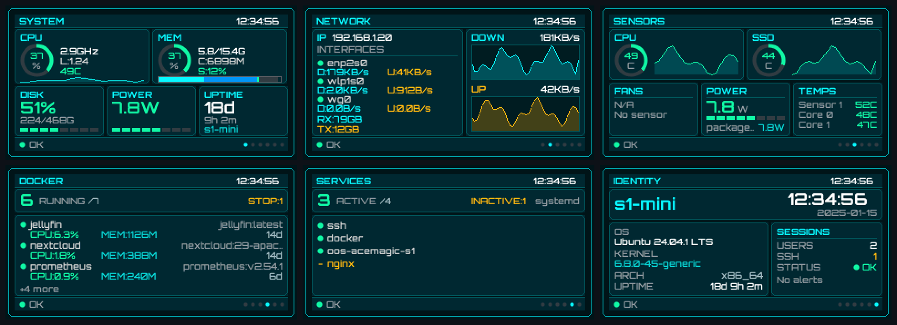

# oos-acemagic-s1

A system dashboard for the front display of the **Acemagic S1** mini PC on Linux.
It runs as a small systemd service and shows six rotating pages on the built-in
320x170 panel, styled after the oOS embedded UI (Orbitron type, navy and cyan).



*Screenshots are rendered by the bundled preview tool from sample data.*

- **System**: CPU load, frequency, load average and temperature; memory with a
  used / cache / buffers bar; disk use; CPU package power; uptime
- **Network**: primary address, per-interface speeds, totals since boot, and
  download / upload history graphs
- **Sensors**: CPU and SSD (or GPU) temperature gauges with history; power by
  domain; every other temperature sensor
- **Docker**: running / total counts and the containers that matter most:
  unhealthy first, then the busiest
- **Services**: state of the systemd units you choose
- **Identity**: hostname, clock, OS, kernel, uptime, login sessions and alerts

The footer of every page shows the machine's health: `OK`, or the most serious
alert and how many more there are.

| Healthy | With alerts |
| --- | --- |
|  |  |

## Requirements

- An Acemagic S1 (or a rebrand with the same front panel). Check with:

  ```
  lsusb -d 04d9:fd01
  ```

  If that prints a "Holtek Semiconductor" line, the panel is there.
- Linux with systemd. Developed and tested on Ubuntu 24.04; the installer also
  knows `dnf`, `pacman` and `zypper`, but those paths have not been tested.
- Optional: Docker for the Docker page; an Intel CPU for the power readings.

## Install

```
git clone https://github.com/IO-Nji/oos-acemagic-s1.git
cd oos-acemagic-s1
sudo ./install.sh
```

The installer:

1. installs the build tools if they are missing (a C++17 compiler, CMake,
   pkg-config and the libusb-1.0 headers),
2. builds the program and runs its tests,
3. installs `/usr/local/bin/oos-acemagic-s1`, the systemd unit, and
   `/etc/oos-acemagic-s1/config.conf`,
4. stops and disables a service called `s1panel` if one is running, because only one
   program can drive the panel (nothing is deleted),
5. enables and starts the service.

The display should come up within a few seconds. Check on it with:

```
systemctl status oos-acemagic-s1
journalctl -u oos-acemagic-s1 -f
```

To upgrade, `git pull` and run `sudo ./install.sh` again; your settings are kept.

Options: `--no-deps` skips the package manager, `--no-start` installs without
starting the service.

## Configure

Edit `/etc/oos-acemagic-s1/config.conf`, then `sudo systemctl restart oos-acemagic-s1`.

```ini
# Seconds each page stays on screen (2 to 3600)
page_interval = 5

# Pages to show, in this order. Leave one out to hide it.
pages = system, network, sensors, docker, services, identity

# systemd units listed on the Services page. Units that do not exist are skipped.
services = ssh, docker, oos-acemagic-s1, nginx, apache2, mysql, mariadb, postgresql, redis

# Filesystem shown in the DISK card and watched for the disk alert
disk = /
```

Every line is optional. A mistake in the file is reported in the journal and the
affected setting keeps its default; the service still starts.

## Alerts

| Footer text | Raised when | Level |
| --- | --- | --- |
| `n SVC FAILED` | a watched systemd unit is in the failed state | critical |
| `DISK nn%` | the watched filesystem is 90 % full (97 %: critical) | warning |
| `CPU nnC` | the CPU package reaches 85 C (95 C: critical) | warning |
| `n CTR UNHEALTHY` | a container is unhealthy, restarting or dead | warning |
| `MEM nn%` | memory in use reaches 92 % | warning |

Colours mean the same thing everywhere: green is fine, amber needs a look, red is a
problem. Gauges and percentages turn amber at 60 % and red at 85 %; temperatures at
60 C and 85 C.

## Uninstall

```
sudo ./uninstall.sh            # keeps /etc/oos-acemagic-s1
sudo ./uninstall.sh --purge    # removes the settings too
```

## Troubleshooting

**The service keeps restarting with "Cannot open the S1 panel".**
Run `lsusb -d 04d9:fd01`. No output means the machine has no S1 panel. If the
journal says the interface is busy, another program is driving the display; stop it.

**The panel shows a "disconnection" notice.**
That is the panel's own screen when nothing is talking to it. Start the service.

**POWER shows N/A.**
Power comes from Intel RAPL counters, which only root can read. The service runs as
root; the preview tool run as a normal user will show N/A. AMD CPUs are not supported.

**FANS shows N/A.**
The S1 does not expose its fan to the operating system.

**Docker page says "Docker not available".**
The `docker` command is missing or the daemon is not running.

**A page change wipes down the screen.**
The panel's USB link moves 64 bytes per millisecond, so a full repaint takes about two
seconds. Small changes (the clock, a value) take a fraction of that. See
[docs/PROTOCOL.md](docs/PROTOCOL.md).

## How it works

```
src/core   drawing, Orbitron glyphs, theme, settings, changed-region tracking
src/hw     USB device and the panel transport
src/data   providers (system, network, sensors, docker, services, identity),
           background collection, health evaluation
src/ui     page frame and the six pages
tools      offline preview renderer, font baking script
tests      unit tests
```

- Data is collected on background threads, each source at its own pace (1 s for
  CPU, memory and network; 2 s for sensors; 10 s for Docker and systemd), so
  drawing never waits on a slow command.
- The display is updated by sending only the rectangles that changed. The panel's
  full-screen redraw command is avoided because the firmware stops responding for
  several seconds after each one; the details are in [docs/PROTOCOL.md](docs/PROTOCOL.md).
- The service uses about 1.5 % of one core and 5 MB of memory.
- It runs as root (needed for the power counters and the Docker socket) with
  `NoNewPrivileges`, a read-only system and home, and a private `/tmp`.

## Development

Build without installing:

```
cmake -S . -B build && cmake --build build -j
```

The build runs the unit tests and a layout check that fails if any text overlaps,
leaves the frame, or a theme colour has less than 4.5:1 contrast. On a machine
without libusb, add `-DOOS_BUILD_SERVICE=OFF` to build only the preview tool and tests.

Render the pages to PNG without a panel:

```
build/oos-s1-preview --live --out DIR                      # this machine's data
build/oos-s1-preview --mock typical --scale 2 --out DIR    # sample data
build/oos-s1-preview --mock stress --out DIR               # worst-case widths
build/oos-acemagic-s1 --dry-run                            # full loop, no USB
```

Changing the look:

- **Colours** live in `src/core/theme.hpp` as named roles; pages never use raw colours.
- **Fonts**: sizes and weights are set in `tools/bake_fonts.py`. Download the
  [Orbitron](https://fonts.google.com/specimen/Orbitron) static TTFs, then run
  `python3 tools/bake_fonts.py path/to/Orbitron/static` (needs Pillow) to regenerate
  `src/core/font_orbitron.cpp`.

## Credits and licence

- Panel protocol: [tjaworski/AceMagic-S1-LED-TFT-Linux](https://github.com/tjaworski/AceMagic-S1-LED-TFT-Linux).
- Font: [Orbitron](https://fonts.google.com/specimen/Orbitron) by The Orbitron Project Authors,
  SIL Open Font License 1.1 (`third_party/Orbitron-OFL.txt`).

Licensed under the [GNU General Public License v3.0](LICENSE).

This project is not affiliated with Acemagic.
